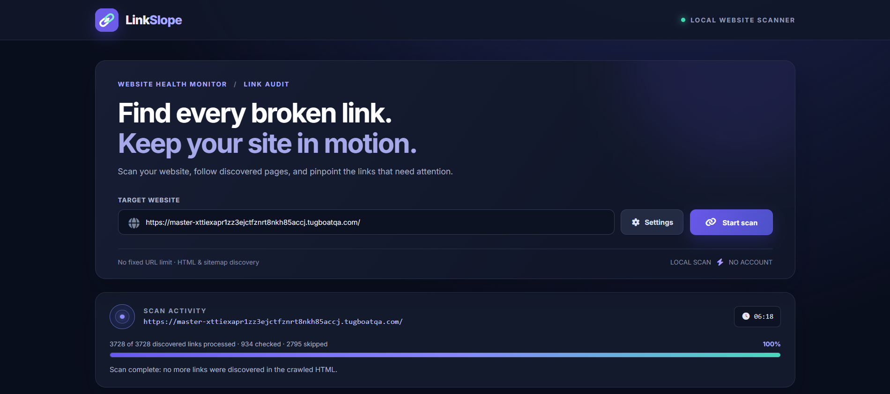
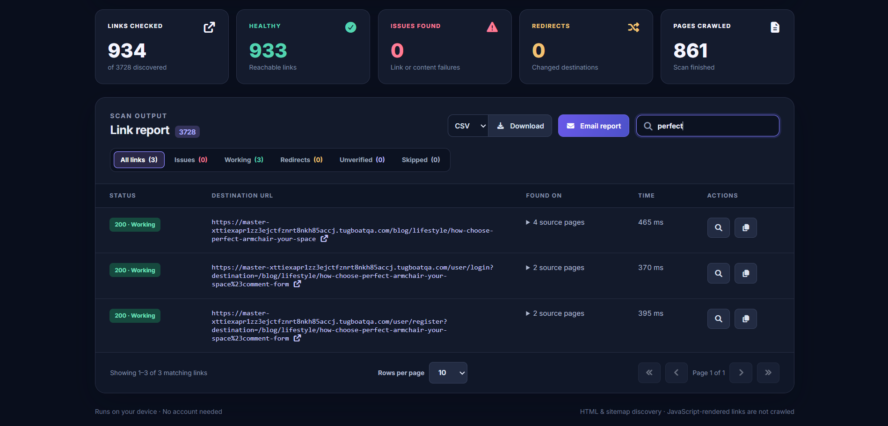
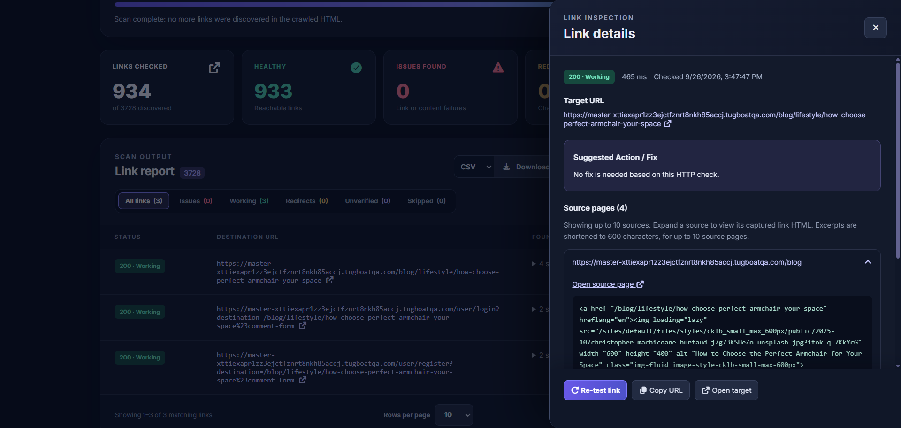
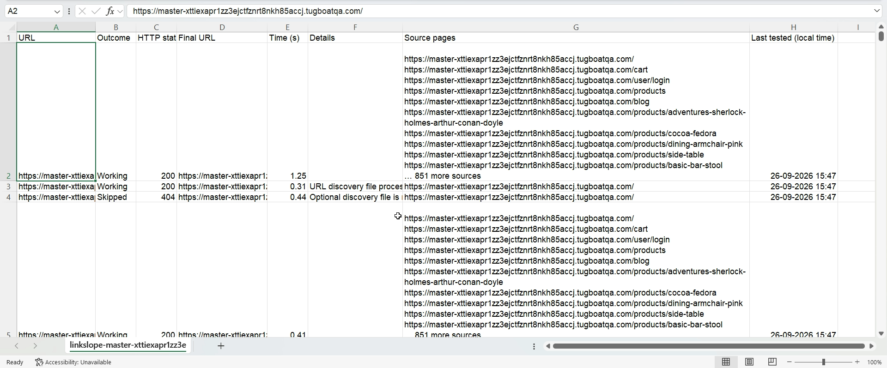
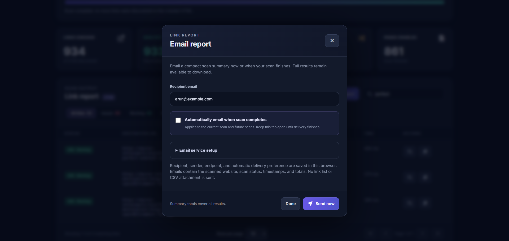

# LinkSlope

A React Chrome extension that crawls HTML pages and checks discovered links. Requests run in the extension tab of the browser, on your device.

Find broken links, trace them back to their source pages, check images and other resources, and download a report as CSV or JSON. Optional email delivery sends a compact scan summary through your configured email service.

[Install](#build-and-install) · [How to use](#how-to-use-linkslope) · [Try the local website](#try-it-with-the-local-test-website) · [Tests](#tests) · [Detailed behavior and limits](#mvp-limits)

## Build and install

Use Node.js 24 or later and Chrome 116 or later. Download or clone this repository, open a terminal in the project directory, and run:

```sh
npm ci
npm run build
```

1. Open `chrome://extensions` in Chrome and enable **Developer mode**.
2. Click **Load unpacked** and select the generated `dist` directory inside this project.
3. Open Chrome's extensions menu and click **LinkSlope — Broken Link Checker**. You can pin it for easier access.
4. LinkSlope opens in its own tab, ready for a scan.

After updating the source, run `npm run build` again, click **Reload** on LinkSlope's card in `chrome://extensions`, and reopen the scanner.

`npm run dev` previews the interface only; scanning requires the installed extension.

## How to use LinkSlope

### 1. Enter a website and start scanning

Enter a full HTTP or HTTPS URL in **Target website**, such as `https://example.com`. Open **Settings** if you want to adjust the scan, then click **Start scan**.

By default, LinkSlope follows internal HTML links with no page or depth limit and reads URLs from robots.txt and sitemaps. External checks and resource crawling are off. For a smaller first scan, set **Maximum pages to crawl** to a positive number such as `25`, or enable **Run once** in Advanced crawl settings to crawl only the starting page and check its links.

Keep the scanner tab open while it works. The activity panel shows progress and the completion message. **Pause** lets an active request finish and holds the remaining queue; you can edit settings and click **Resume**. **Stop** cancels the scan and preserves partial results. Closing or reloading the tab loses the in-memory scan.



### 2. Choose what to check

Use **Settings** before starting, or while paused. Settings changes apply to future requests; completed pages are not revisited.

| What you want to do | Setting to use |
| --- | --- |
| Limit the scan size | Set **Maximum pages to crawl**; `0` means no page limit. |
| Limit how far links are followed | Disable **Unlimited crawl depth** in Advanced crawl settings, then set **Maximum crawl depth**. |
| Check only the starting page's links | Enable **Run once** in Advanced crawl settings. |
| Check links to other websites | Enable **Test external URLs**. External pages are checked without crawling their links. |
| Check images, stylesheets, and scripts | Enable **Crawl resources like images, stylesheets, and scripts** in Advanced crawl settings. Enable external checks too for assets on other origins. |
| Include other hosts in the crawl | Add exact hostnames under **Accepted hosts**. |
| Skip paths such as logout URLs | Add one rule per line under **Ignore prefixes**, for example `/logout`. |
| Adjust request speed or waiting time | Set **Rate limit (requests per minute)** and **Timeout (seconds)**. A rate of `0` means no pacing delay. |
| Check page text or HTML | Expand **Content checks** and fill **Check presence** or **Check absence**. |
| Scan a site using a browser login | Expand **Authentication** and enable **Use browser cookies** after logging into the site in the same Chrome profile. |

The scanner reads response HTML; it does not run website JavaScript. Links and assets created only by JavaScript are not discovered. Scan settings reset when you reload the extension tab.

### 3. Review and filter the results

The summary cards show checked links, healthy links, issues, redirects, and crawled pages. In **Link report**, use **Search URLs** to find a destination, select a filter, and adjust **Rows per page** or use the page controls.

| Filter | What it shows |
| --- | --- |
| **All links** | Every discovered URL matching the search. |
| **Issues** | Broken links, server errors, and failed content checks. |
| **Working** | Links classified as reachable. A working HTTP response can still fail a configured content check. |
| **Redirects** | Requests whose final URL differs from the original destination. |
| **Unverified** | Inconclusive requests, access restrictions, and rate-limited responses. |
| **Skipped** | URLs excluded by scope or settings, plus missing optional discovery files. |

Filter counts follow the current search. A skipped URL is not automatically broken; open its details to see why it was skipped.



### 4. Inspect a link and check a fix

Click the magnifying-glass button in a row's **Actions** column to open **Link details**. Review its status, request time, destination, and suggested action. Expand a source page to see the captured HTML that linked to the target; **Open source page** helps you locate the link to fix.

After correcting the website, click **Re-test link** to check that destination again. Re-testing is available after a scan finishes or stops and updates the row and summary. It does not crawl new pages or refresh the captured source HTML; start a new scan to refresh those. Use **Copy URL** or **Open target** as needed, and press Escape or click the close button to return to the report.



### 5. Download the full report

When the scan finishes or stops, choose **CSV** or **JSON** beside **Download**, then click **Download**. Exports include all results, even when the table is filtered or showing only one page.

Open CSV in a spreadsheet application to review URLs, outcomes, HTTP status, final destinations, timing, source pages, and last-tested times. JSON also includes scan metadata, summary counts, and whether the scan was partial. Downloads include subsequent re-test results.



### 6. Optionally email a summary

Click **Email report**, enter the recipient, and expand **Email service setup** to configure your HTTPS email endpoint, any requested sender address, and any required API token. An email service must be configured before sending; entering a recipient alone is not enough.

Click **Send now** after a scan finishes or stops, or enable **Automatically email when scan completes** for normal and limited completion. Keep the tab open until sending finishes. Emails contain summary totals, timestamps, and the scanned website; download CSV or JSON for individual link results. Email preferences are saved locally, while the API token lasts only for the current session. See [Report downloads and email](#report-downloads-and-email) for endpoint behavior.



## Try it with the local test website

Run the included demonstration website:

```sh
npm run test:site
```

Open [the resource playground](http://127.0.0.1:4174/resources) in your browser, or enter `http://127.0.0.1:4174/resources` as the extension's target website. Enable **Crawl resources like images, stylesheets, and scripts** and **Test external URLs**, and disable **Read URLs from robots.txt and sitemap.xml** for this example.

The playground includes working and deliberately broken links, images, CSS, and JavaScript. A second local server on port `4175` supplies external links and resources. Missing images and 404 responses are intentional. Keep the terminal running during the scan; press Ctrl+C to stop both servers.

## Tests

### Playwright extension tests

To inspect the same local website used by the tests, run `npm run test:site` and open <http://127.0.0.1:4174>. Keep the terminal running; Ctrl+C stops the server. You can also enter that URL in the installed extension. Disable **Read URLs from robots.txt and sitemap.xml** to match the automated scan setup.

The homepage links to healthy (200), missing (404), redirect (302), and skipped external destinations. Visit `/many` directly for 12 links to exercise pagination, or `/slow` for a five-second response delay to try pause/stop. Automated tests control the slow response explicitly instead of waiting five seconds. Set the `PORT` environment variable to use a different port. The shared routes live in `e2e/test-site.js`; the standalone launcher is `scripts/test-site.js`.

Open <http://127.0.0.1:4174/resources> for the resource playground: local and external SVG images, CSS, JavaScript, working/missing pages, redirects, and deliberately missing image/CSS/JS files. The external origin runs on port 4175 (override with `EXTERNAL_PORT`). Both servers start and stop together. The second port is a separate HTTP origin; no public service is needed for these examples. Enable **Crawl resources like images, stylesheets, and scripts** to discover assets, and **Test external URLs** to check the second origin. With external checks off, external URLs appear as Skipped. Broken image placeholders and failed asset requests are intentional. Scanning reads the HTML without executing the scripts; opening the playground in a browser runs them.

Install the browser once with `npx playwright install chromium`, then run:

```sh
npm run test:e2e
npm run test:e2e:headed
npm run test:e2e:report
```

The first two commands build the extension before running the tests; the third opens the last HTML report. After building, use `npx playwright test --grep "pauses"` to run one case or `npx playwright test --ui` to open Playwright's interactive runner.

Tests in `e2e/` load `dist/` into Playwright's bundled Chromium with a fresh temporary profile for each test. They exercise the real extension page, browser fetches, and Chrome redirect observation against isolated local HTTP servers. They cover settings validation, status classification, filters/search, source inspection, re-testing, pagination, CSV/JSON downloads, pause/resume/stop, redirect exclusions, and content checks. No public websites or email services are contacted. The extension page is opened directly; toolbar clicks, installation permission prompts, and email delivery are not covered by this suite. Traces and screenshots are retained for failures in `test-results/`.

Use bundled Chromium rather than installed Chrome or Edge for extension loading, following [Playwright's extension testing guide](https://playwright.dev/docs/chrome-extensions).

### GitHub Actions

`.github/workflows/tests.yml` runs on pushes, pull requests, and manual dispatch from the repository's **Actions** tab. It uses Ubuntu with Node.js 24, installs locked dependencies with `npm ci`, runs the Node tests, installs Playwright's Chromium and Linux dependencies, then builds and tests the extension. The test fixtures start their own local websites; no separate server command or secrets are needed. This follows [Playwright's CI setup](https://playwright.dev/docs/ci).

Upload the project including `.github/workflows/tests.yml`, `package-lock.json`, `e2e/`, `test/`, `src/`, and `public/`. Keep generated directories (`node_modules/`, `dist/`, `playwright-report/`, and `test-results/`) out of the repository. After a run, download **playwright-results** from the run's Artifacts section for the HTML report and any failure screenshots/traces; artifacts are retained for 14 days. GitHub execution is verified on the first run after pushing.

### Node logic tests

Use Node.js 24 or later. Run `npm test` for the controlled crawler suite, or `npm run test:coverage` for coverage. Tests use a real HTML parser and Fetch response streams with mocked network requests and accelerated pacing, so they do not contact external websites.

Coverage includes URL handling, status classification, internal crawling, external link checks, redirects, base URLs, source tracking, deduplication, page/depth limits, network failures, timeouts, cancellation, and oversized HTML. Settings defaults and validation live in `src/settings.js`; the grouped, initially collapsed gear panel lives in `src/SettingsPanel.jsx`. Settings apply to the next scan or to remaining work when edited while paused, and reset on reload. The coverage report measures imported logic modules; it does not measure the React interface or extension background script. Chrome permission prompts, browser suspension, and real website behavior still require browser-level verification.

## MVP limits

- All scanner requests use `cache: no-store`: HTML pages, resources, robots.txt, sitemaps, redirects, automatic retries, and manual re-tests bypass the browser HTTP cache and do not populate it. There is no cache setting. Website/CDN caching remains controlled by the remote server.

- **Automatically retry rate-limited requests (429)** (Advanced crawl settings) defaults to off. During scans, enabling it retries a URL up to three times after its initial attempt. Retry-After supports seconds and HTTP dates; missing or invalid values use 5/15/45-second delays plus up to 1 second of jitter. Zero or past dates wait at least 1 second. The requested and final response hosts share a cooldown while other queued hosts continue, subject to the global request rate. The progress panel shows cooldown status. Pause and Stop remain available; disabling retries while paused leaves pending retries as Rate limited. Checked totals count unique URLs, not attempts. Retries bypass the HTTP cache, and exhausted URLs remain Rate limited. Manual Re-test remains a single attempt.

- **Crawl resources like images, stylesheets, and scripts** (Advanced crawl settings) defaults to off. When enabled, crawled HTML also contributes image src/srcset URLs, picture source srcset candidates, image input src URLs, stylesheet links, and script src URLs. These requests share the normal scope, exclusions, authentication, pacing, timeout, and pause/stop behavior. External resources require Test external URLs or an accepted host. Resources appear in the report with their source markup, are deduplicated with regular links, and are never rendered or executed. Resource-only URLs do not consume the HTML page crawl limit or expand into further pages. CSS imports/background images, JavaScript imports, and dynamically generated asset URLs are not recursively discovered. Turning the option off while paused skips remaining resource-only requests.

- **Read URLs from robots.txt and sitemap.xml** defaults to on. The scanner requests the starting site's root robots.txt and sitemap.xml, follows Sitemap directives and nested XML sitemap indexes, and supports gzip-compressed sitemap files. It reads page URLs from direct loc elements, deduplicates them with HTML links, and records their source file. Sitemap pages enter at depth 1; metadata files do not consume the page crawl limit. Discovered URLs respect accepted hosts, external URL settings, exclusions, credentials, pacing, timeouts, pause, and stop. Run once suppresses this discovery. Missing optional files (404/410) appear as Skipped; invalid or unreadable XML is Unverified and HTML crawling continues. Discovery requests appear in the report and checked count. Compressed and decompressed files are each limited to 2 MB. Robots Allow/Disallow patterns are neither scanned as URLs nor imported as exclusions. [Sitemap protocol](https://www.sitemaps.org/protocol.html).

- Keep the scanner tab open and the computer awake. Closing, reloading, browser suspension, or shutdown can interrupt scanning; there is no persisted recovery yet.
- **Pause scan / Resume scan** holds the current queue in memory. An active request finishes, then no further URLs are requested until resumed. Settings are disabled while scanning and editable while paused. Resume validates the changes and applies them to future requests; an active request retains its original settings. Completed pages are not revisited, so expanding scope or depth does not recover links from previously processed pages. Queued URLs excluded by an updated scope are marked Skipped. **Stop scan** cancels the active request and remaining queue, including while paused, and preserves partial results. A stopped scan cannot be resumed; Start scan starts a new scan.
- Maximum pages to crawl accepts any nonnegative whole number, defaults to 0, and uses 0 for no page limit across the starting origin and accepted hosts. Unlimited crawl depth is enabled by default to follow discovered pages at any depth; Run once still overrides it. The report marks pages checked but not crawled due to depth or page limits, and the final status shows Limited with the affected counts when discovery was restricted. There is no fixed unique URL limit.
- **Run once** (`run-once`) defaults to false: only crawl the starting page and check its discovered links, equivalent to crawl depth 0. Overrides the depth setting while enabled.
- **Maximum crawl depth** (`crawl-depth`) accepts nonnegative whole numbers and retains 1 as the limit when Unlimited crawl depth is disabled. Unlimited crawl depth is enabled by default. The starting page is depth 0; depth 1 also crawls directly linked pages. Links discovered on pages at the maximum depth are checked without parsing their pages. Accepted hosts follow the same depth limit; redirects do not add depth. The page limit still applies.
- **Test external URLs** defaults to off. Enable it to check discovered URLs outside the crawl scope without crawling those pages. While disabled, discovered external links appear as Skipped in the report with their source pages. Existing automatic redirect following still applies, so an in-scope URL can redirect to an external host.
- **Accepted hosts** defaults to blank: add comma- or whitespace-separated hostnames such as `example.com, subdomain.another.com` to expand the crawl scope. Exact hostnames only (no URLs, paths, ports, or wildcards); subdomains must be listed separately. Accepted hosts are crawled even with external checks off. Hosts are reached through discovered links, not added as separate starting URLs.
- **Ignore prefixes** (`ignore-prefixes`) defaults to blank. Enter one rule per line, such as `example.com/logout`, `/logout` (any host), or `www.example.com/ignore_this_and_after/`. Path-only rules match at any path segment: `/logout` excludes `/logout`, `/user/logout?token=...`, and nested logout paths, but not `/user/mylogout` or a query value containing `/logout`. Host/path rules match literal prefixes from the start of the path, with exact host matching and case-sensitive paths; optional HTTP(S) schemes are accepted and either scheme is matched. Query strings can be included. For regex use `regex: example\.com/(logout|signout)(?:[/?]|$)`; escaped patterns such as `www\.example.com/ignore_this_and_after/` and patterns starting with `^` are also treated as regex. Regex matches the beginning of host/path/query without the scheme. Invalid rules show inline validation. Matching links appear as Skipped with their exclusion reason and source pages, without being queued or requested; a matching starting URL or an already queued URL excluded after editing while paused is marked Skipped without being requested. Rules cover internal, accepted, and external hosts. With rules configured, redirects are handled one hop at a time. The extension observes redirect response headers through Chrome webRequest, checks each destination before requesting it, follows allowed destinations, and marks redirects to excluded URLs Skipped. Relative redirects and chains are supported, with a limit of 20 redirects and loop detection. Authorization is recalculated for each hop and remains limited to the starting origin. Cookies follow the browser cookie setting. The original request timeout covers the full redirect chain. Missing or inaccessible redirect metadata is reported Unverified without following the redirect. Observation listeners are scoped to the scanner document and removed after each request. This requires the webRequest manifest permission; reload the extension after updating. An active request cannot be undone by adding a rule; configure logout exclusions before starting a cookie-authenticated scan.
- **HTTP authentication**: username and password default to blank (disabled). Supplying either enables Basic authentication; the other may be blank. Credentials are UTF-8 encoded, kept only in page memory, and sent only to the starting origin (same scheme, hostname, and port), never to accepted or external origins. Use an HTTPS starting URL. Browsers strip Authorization on cross-origin redirects; start directly at the authenticated destination when needed.
- **Use browser cookies** defaults to off. Enable it under HTTP authentication to scan with existing website logins from the same Chrome profile. Requests use `credentials: include`; Chrome attaches each destination's matching cookies, including for external checks and redirects, and may accept response cookies. Cookie values are not read or displayed by the scanner. Log in first; browser cookie restrictions still apply, and login tokens stored only in local storage are not supported. A manual Cookie header remains unavailable; its validation message points to this setting. It can be changed while paused for remaining requests.
- **Custom headers**: one `Header-Name: value` per line, defaulting to `X-Scanned-By: LinkSlope`. Clear the field to omit custom headers. Multiple entries and values containing colons are supported; repeated names are combined. Headers apply to all checked URLs and redirects, so do not put secrets in general custom headers. A custom `Authorization` header is scoped to the starting origin and cannot be combined with Basic authentication. Malformed and browser-controlled headers are rejected before scanning.
- Follows redirects. Does not execute target JavaScript, detect soft 404 pages, or validate fragment identifiers.
- Requests run one at a time and omit cookies unless Use browser cookies is enabled. **Timeout** defaults to 10 seconds and accepts positive whole seconds. **Rate limit (requests per minute)** defaults to 0 (unlimited, no pacing delay); positive whole values space request starts evenly across all hosts. Automatic redirects can generate additional requests. Stopping a scan also cancels a rate-limit wait. Authenticated sites, bot protection, and network errors can produce unverifiable results.
- Parses at most 2 MB of HTML per page. Respects the selected crawl limits; robots.txt Allow/Disallow rules are not enforced.
- Website permissions cover HTTP(S) sites because discovered links can point to arbitrary domains. Website access is declared as a required installation permission; starting a scan does not request additional permissions. Existing installations may need Chrome's approval for the updated required permissions. Chrome's extension site-access controls can still restrict access.
- 404/410 are broken; access restrictions, rate limits, server errors, and inconclusive requests are reported separately.

## Later

Persisted queues and resume, background batch processing, per-host throttling and retry/backoff, and optional rendered-page crawling.

## Report downloads and email

The Scan output header exports all results as CSV or JSON after a scan completes or stops, regardless of search, filter, or pagination. CSV columns are URL, Outcome, HTTP status, Final URL, Time (s), Details, Source pages, optional Content checks, and Last tested (local time). Durations below 10 seconds use two decimal places; durations of 10 seconds or more are rounded to whole seconds. Last tested uses the exporting device’s local timezone in YYYY-MM-DD HH:mm:ss format. Content checks is omitted when no result has a Passed or Failed check; when present, it retains Not checked details for other rows. JSON additionally includes the website, scan timestamps and status, summary counts, and crawl limits. Stopped, limited, and failed scans are marked partial in JSON. Downloads reflect any subsequent re-tests. Source HTML excerpts and scanner credentials are excluded. CSV cells escape quotes and neutralize spreadsheet formula prefixes. CSV is available as a local download; emails contain only a compact summary.

The Email report button opens a popup with Send now and automatic delivery options. You can update automatic delivery while a scan is running; completion uses the latest settings. Email settings persist in this extension's local browser storage: recipient, sender address, HTTPS endpoint, and automatic delivery preference. They do not sync across devices. The optional endpoint Bearer token is session-only. Storage failures are shown in the panel. Other scan settings still reset on reload.

Emails include only the website, scan status, timestamps, and aggregate totals (discovered, checked, crawled, issues, working, broken, server errors, unverified, skipped, redirects, and content failures). No individual URL records, source pages, HTML, or CSV attachments are transmitted. Email payload size does not grow with the number of links. CSV and JSON downloads still include the full results.

Custom HTTPS email services receive a JSON POST with `to` (a string), `subject`, `text`, and `report` (summary metadata and totals only). The former `attachment` and `report.records` fields have been removed; update custom services that relied on them. Configure your service to send the supplied summary. An optional session token is sent as `Authorization: Bearer …`. The endpoint should return a 2xx status only after accepting responsibility for sending. Cookies are omitted and redirects are rejected. Preview-mode calls also require appropriate CORS configuration.

Automatic email defaults to off. When enabled, configuration is validated before scanning, then one request sends the final scan summary on normal or limited completion, even when no broken links were found. Stopped or failed scans do not trigger automatic email; their available results can be emailed manually. Sending errors do not discard results or change scan success. Delivery has a 30-second timeout and is not retried automatically because an unconfirmed request may already have sent mail. Check your service before manually retrying. A successful endpoint response confirms acceptance, not inbox delivery.

Keep the scan tab open and the computer awake through email acceptance. Automatic delivery does not provide background scanning or survive closing/reloading the tab. No real email is sent by the automated tests; transport tests use mocked endpoints.

## Local styles, icons, and fonts

Tailwind CSS is compiled by the Vite plugin, alongside the custom scan design styles. Font Awesome Free solid icons and Inter Variable (the Inter family available from Google Fonts, distributed through Fontsource) are installed through npm and bundled into the extension. No CDN scripts, remote stylesheets, or Google Fonts requests are used.

Run npm install once with network access to obtain dependencies. After installation, builds use local packages. The generated dist directory includes the CSS, JavaScript, WOFF2 font files, and font/icon licenses and can display the interface offline. Scanning websites still requires network access.

## Link report and inspection

The report has 10/25/50/100-row pagination (25 by default), request time, and inspect/copy actions. Search and filter counts cover all matching results, not just the current page. Time measures elapsed time to response headers including redirects, or elapsed time until a failed request; unrequested links show a dash.

Inspect opens a keyboard-accessible dialog with status, timing, destination, source links, suggested fixes, and new-tab links. The crawler retains one HTML link excerpt per source for up to 10 sources per target, each capped at 600 characters. Excerpts are escaped text, captured during crawling, and are not refreshed by a target re-test. HTTP redirect sources may have no HTML excerpt.

Re-test checks only the selected target and updates its row and summary/filter counts. It is available after scanning finishes or stops, uses current Settings with credentials scoped to the original scan origin, respects exclusions and request pacing between re-tests, and bypasses the browser cache. It does not crawl new pages or refresh source HTML.

## Content checks

Settings includes **Check presence** (require a match) and **Check absence** (forbid a match). Each field accepts one literal text or HTML snippet, including newlines, or a JavaScript regular expression prefixed with `regex:` (for example, `regex:<title>[^<]+</title>`). Matching is case-sensitive, preserves whitespace, and searches the raw response source, not rendered text. Leave a field empty to disable it. Invalid patterns prevent scanning or resuming.

Checks run on every fetched HTML or textual response, including checked external pages and pages beyond crawl limits, without discovering extra links. Ignored URLs are not requested. Binary or untyped responses and incomplete downloads are not evaluated; unread content never counts as passing. The existing timeout and 2 MB download limit apply. Results show Passed, Failed, or Not checked alongside HTTP status, and content failures appear under Issues. Re-test applies the current content settings. Changes while paused apply only to future requests.

## Source references

Source references are limited to the first 10 per target in the report table, inspection popup, CSV, and JSON. Additional references are summarized as “... N more sources” (with an ellipsis glyph). Table and popup headings retain the full source count. JSON stores the first 10 URLs in `sources`, the full count in `sourceCount`, and a `sourcesSummary` message when references are omitted. The crawler retains the complete source list in memory.

